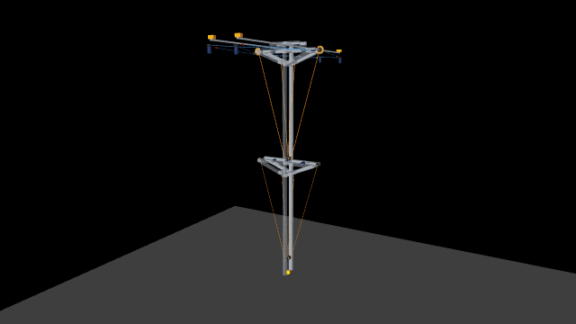

# Robotic shoulder — a big arm moved by small motors



A two-stage robotic shoulder simulated in [MuJoCo](https://mujoco.org): a 4.8 m
structure that moves **50 kg at the tip** using two **windshield-wiper motors**
(0.64 N·m stall, ~50 W each). The trick is the reduction: a **self-locking 1:50 worm
gear** plus a **chain** (1:6 on stage 1, 1:3 on stage 2) winding steel cables.
Low power, high torque, and no backdriving when the motors stop.

## What's simulated

- **Two stages** hanging one from the other (axis 1-2 and axis 1'-2'), each moved by
  two cables on opposite sides.
- **Synchronized cables**: both cables of a stage follow one reference angle, each
  wound exactly as much as the geometry requires for that angle (from a precomputed
  table), so no cable ever goes slack whatever the direction of the load.
- **Real motor dynamics**: rotor inertia reflected through the gearing, DC-motor
  torque/speed curve (max torque at stall, zero at no-load speed), soft start, a speed
  regulator with load compensation, and a brake that holds the spool on target.
- **Steel cables** as one-way springs: tension = EA/L × stretch when taut, zero when
  slack, with damping — so tensions and breaking-load margins are realistic
  (8 mm cable on stage 1, 5 mm on stage 2).
- **Cart**: the whole arm hangs from a T-shaped carriage on two rails (±1.31 m along y)
  with a turntable (±30°), driven by four motors with crossed cables.
- **Reach zone**: a red 3D halo shows every point the tip can reach; an automatic
  sweep moves rails, turntable and both stages through the whole volume, leaving a
  green trail.

## Run it

```bash
pip install -r requirements.txt
python live.py        # on macOS: mjpython live.py
```

The viewer opens with sliders in the **Control** panel:

| Slider | What it does |
|---|---|
| `winding` / `winding_s2` | cm of cable to wind on stage 1 / stage 2 (→ arm angle) |
| `position_y` | cart position along the rails (m) |
| `rotation` | turntable angle (degrees) |
| `auto_sweep` | 1 = sweep the whole reachable volume automatically |

`live.py` reloads `shoulder.mjcf.xml` every time you save it, keeping the camera
where it was — handy for editing the geometry while the simulation runs. A text box
shows angles, cable wound, tensions (and % of breaking load) and motor state.

## Files

| File | |
|---|---|
| `shoulder.mjcf.xml` | the model: steel tubes (5×5 cm, 3 mm wall), rails, cart, pulleys, gears, chains, cables |
| `control.py` | motors, gearing, cable physics, synchronization and brakes |
| `reach_zone.py` | reachable-volume halo and automatic sweep |
| `live.py` | viewer with live reload and the text overlay |

## Numbers from the simulation

With the worm gear (1:50, efficiency 0.6) the chain ratios that worked best were
1:6 on stage 1 (8 mm cable, ~29 s full move, peaks ~4.1–5.1 kN) and 1:3 on stage 2
(5 mm cable, ~13–18 s, ~1.8–2.2 kN). Speed is limited by power (2 × 50 W), so the
ratio changes the times only a little. The weakest point is the 1.5 cm pin of
pulley 2 (bending), not the cables.

## License

MIT — see [LICENSE](LICENSE).
